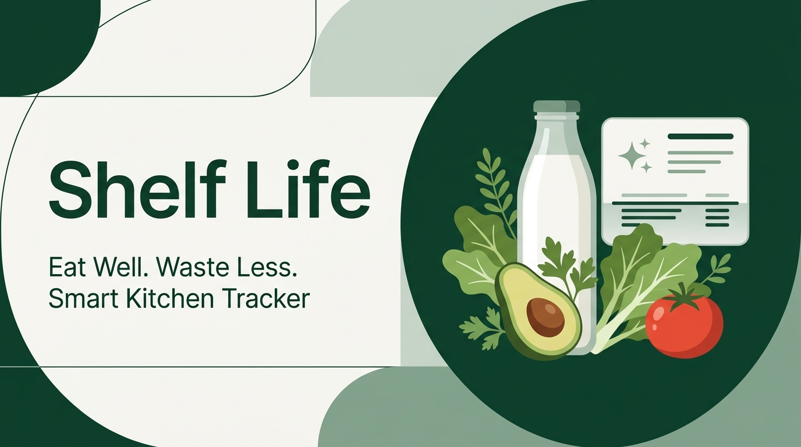
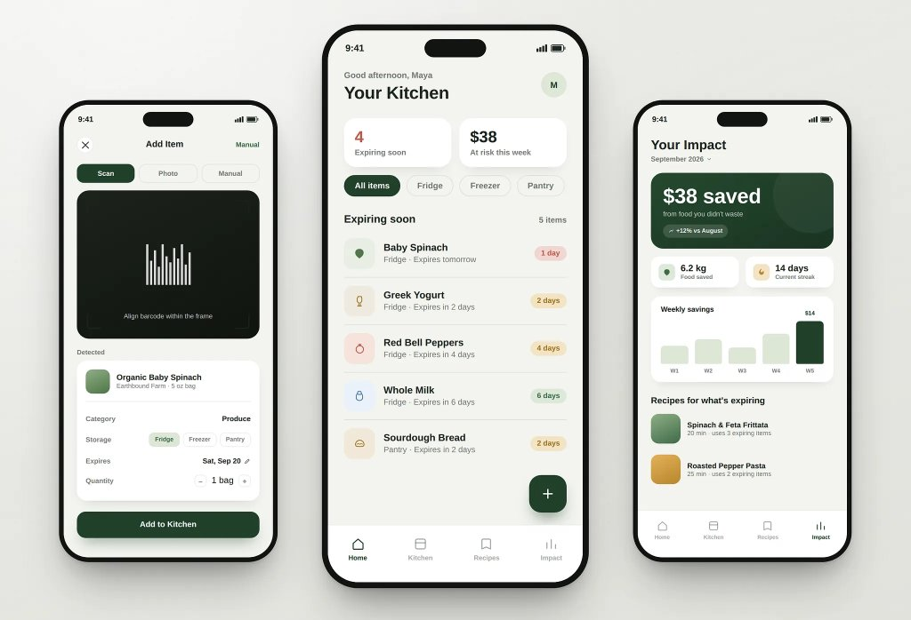
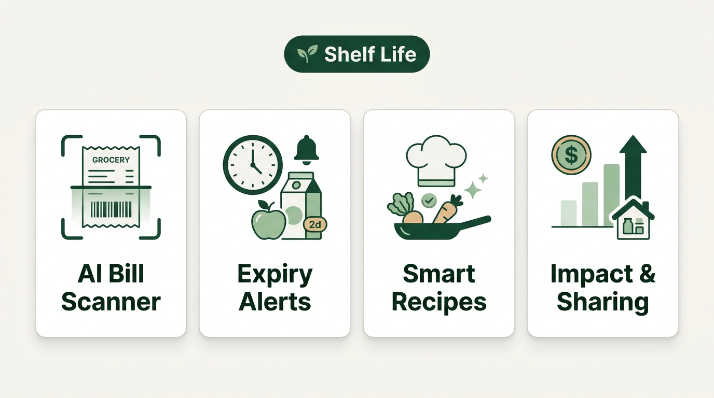
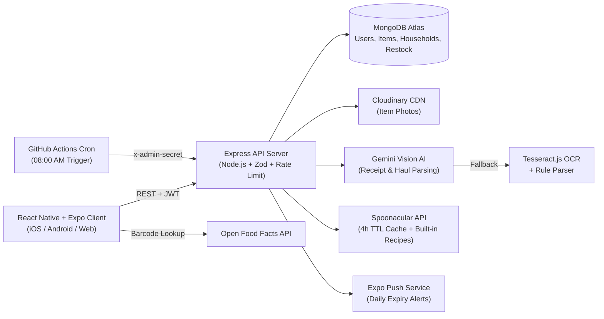

<div align="center">


# Shelf Life

**Eat well. Waste less. Keep food fresh.**

A full-stack mobile & web kitchen inventory tracker powered by **React Native (Expo)**, **Node.js / Express**, **MongoDB**, **Cloudinary**, **Spoonacular**, and **Gemini Vision AI**.

[-124831?style=for-the-badge&logo=android&logoColor=white)](https://github.com/jaydipvaliya/shelf-life-app/releases/download/v1.0.0/application-07b5880a-070e-4a84-b0ff-f36650eef89b.apk)
[](https://github.com/jaydipvaliya/shelf-life-app/releases/latest)
[](https://shelf-life-app-elgp.onrender.com/api/health)
[](https://expo.dev/)
[](https://reactnative.dev/)
[](https://expressjs.com/)
[](https://www.mongodb.com/)
[](https://ai.google.dev/)

<br />

> **Try on Android:** [Download Shelf Life v1.0.0 APK](https://github.com/jaydipvaliya/shelf-life-app/releases/download/v1.0.0/application-07b5880a-070e-4a84-b0ff-f36650eef89b.apk) • [View Release Notes](https://github.com/jaydipvaliya/shelf-life-app/releases/tag/v1.0.0) • [Live API Health](https://shelf-life-app-elgp.onrender.com/api/health)



</div>

---

## App Preview

<div align="center">
  
  <br />
  <sub>Left: Barcode & Open Food Facts Lookup • Center: Kitchen Expiry Dashboard • Right: Financial Impact & Rescue Recipes</sub>
</div>

<br />

<div align="center">
  
</div>

---

## Key Features

### 1. 4-Way Smart Food Capture (`Scan` • `Photo` • `Manual` • `Haul`)
- **Barcode Scanner (`expo-camera` + Open Food Facts):** Scan grocery barcodes in real time to auto-populate product name, category, package photo, and quantity.
- **Photo Capture & Cloud Storage:** Snap or upload item photos resized cleanly via **Cloudinary** (with automatic local fallback in dev).
- **AI Shop Bill / Receipt Scanner (`Gemini Vision` + `Tesseract.js` fallback):** Photograph any supermarket receipt (`Scan Bill` / `Bill Photo`) or paste messy text to extract clean food items, estimated shelf life, storage locations (`fridge` / `freezer` / `pantry`), categories, and item prices — automatically ignoring store metadata, tax lines, and non-food receipts.
- **Quick Batch Add (`POST /api/items/batch`):** Review, edit, or toggle extracted haul items before stocking up to 50 groceries at once.

### 2. Expiry Countdown, Kitchen Filter & Multi-Currency Pricing
- **Automatic Urgency Tiers:** Every item computes `daysUntilExpiry` and maps into `expired`, `urgent` (0–2 days), `warning` (3–5 days), or `safe` (>5 days).
- **Clean Dropdown Filtering:** Search by name and filter via compact dropdown selectors for **Status** (`Active`, `Used`, `Tossed`, `All Status`), **Storage Location** (`Fridge`, `Freezer`, `Pantry`), and **9 Food Categories** (`dairy`, `produce`, `meat`, `bakery`, `pantry`, `frozen`, `beverages`, `snacks`, `other`).
- **Multi-Currency Support:** Track item prices and financial waste savings in `USD ($)`, `INR (₹)`, `EUR (€)`, `GBP (£)`, `CAD (C$)`, `AUD (A$)`, or `JPY (¥)`.

### 3. Smart Kitchen Recipes & Food-Saving Tips
- **Rescue Expiring Ingredients First:** Combines live **Spoonacular** results (cached in-memory for 4 hours) with built-in offline kitchen recipes, prioritizing meals that use items closest to expiry.
- **Actionable Preservation Tips:** Tailored quick tips for milk, leafy greens, berries, bread, meat, and produce right above your recipe matches.

### 4. Smart Restock Shopping List
- **Closed-Loop Restock Prompt:** Marking an item as **Used** or **Tossed** prompts a one-tap add to your shopping list (`RestockItem`), merging quantities automatically instead of creating duplicates.
- **One-Tap Stock Bought:** Check off items while shopping and tap **Move Bought Items to Kitchen** (`POST /api/restock/stock-bought`) to convert them back into active inventory with smart default expiry dates.

### 5. Impact Analytics & Shared Households
- **Waste & Savings Metrics:** Tracks total money saved, weekly savings bar chart (`W1`–`W5`), estimated kg of food saved, monthly percentage delta, at-risk weekly inventory value, and zero-waste streaks.
- **Shared Households:** Create a family/roommate pantry with a 6-character invite code or email invite so household members share active items and restock lists.
- **Daily Push Alerts & Scheduler:** `node-cron` 8:00 AM digest via `expo-server-sdk` (with dead-token auto-cleanup) plus an external GitHub Actions cron workflow for Render Free deployments.

### 6. Production Security & Account Controls
- JWT access tokens + SHA-256 hashed multi-device refresh token rotation (up to 5 concurrent sessions per account).
- Authenticated password updates (`Change Password`), full `Delete Account` cascade, in-app **Privacy Policy & Terms**, dark/light theme toggle, Helmet security headers, strict production CORS allowlisting, Zod request validation, and endpoint rate limiters.

---

## System Architecture



---

## Tech Stack

| Layer | Technologies |
| :--- | :--- |
| **Mobile / Web Client** | React Native `0.86.3`, Expo SDK `57`, TypeScript `6.0`, React `19.2`, React Navigation `7`, TanStack React Query `5`, Zustand `5`, Axios, `expo-camera`, `expo-image-picker`, `expo-notifications`, `expo-secure-store`, `lucide-react-native` |
| **Backend API** | Node.js `>=20`, Express `4.21`, Mongoose `8`, Zod `3`, JWT + `bcryptjs`, `helmet`, `cors`, `express-rate-limit`, `multer` |
| **AI & External APIs** | Google Gemini Vision (`gemini-3.8-flash` fallback chain), `tesseract.js` `7`, Spoonacular Recipes API, Open Food Facts API, Cloudinary `v2`, `expo-server-sdk`, `node-cron` |

---

## Project Structure

```text
├── render.yaml                         # Render Blueprint deployment config
├── .github/workflows/
│   └── daily-expiry-cron.yml           # Scheduled daily push-alert trigger for Render
├── docs/images/                        # README showcase visuals
├── server/
│   ├── server.js                       # Express app bootstrap, middleware, routes, cron
│   ├── .env.example                    # Required backend environment variables template
│   ├── src/
│   │   ├── config/                     # db.js (Atlas + dev memory fallback), cloudinary.js, env.js
│   │   ├── controllers/                # auth, item, household, recipe, restock, analytics, upload
│   │   ├── jobs/                       # expiryCheck.job.js
│   │   ├── middleware/                 # auth.middleware.js, validate.middleware.js, error.middleware.js
│   │   ├── models/                     # User, Item, Household, RestockItem
│   │   ├── routes/                     # Express routers + Zod schemas
│   │   ├── services/                   # aiReceipt.service.js, ocr.service.js, recipe.service.js, notification.service.js
│   │   └── utils/                      # apiError, apiResponse, asyncHandler, haulParser
│   └── tests/
│       ├── api.test.js                 # 20-step end-to-end API integration test suite
│       └── recipe.test.js              # Recipe caching & ingredient matching unit tests
└── client/
    ├── App.tsx                         # QueryClient, auth hydration, push registration, ErrorBoundary
    ├── app.json                        # Expo permissions, icons & plugins config
    ├── eas.json                        # EAS development, preview & production build profiles
    └── src/
        ├── api/                        # Typed Axios clients & React Query hooks
        ├── components/                 # AddItemModal (Scan/Photo/Manual/Haul), BarcodeScannerModal, RestockModal, UI kit
        ├── navigation/                 # RootNavigator (Home, Kitchen, Recipes, Impact)
        ├── screens/                    # Login, Register, Home, Kitchen Search, Recipes, Analytics, ItemDetail, Settings
        ├── store/                      # Zustand auth, theme, currency & API URL store
        ├── theme/                      # Light & Dark palette tokens
        └── utils/                      # Currency formatter, categories, dates, notification helper
```

---

## Getting Started Locally

### Prerequisites
- **Node.js `>= 20`** and **npm**
- **MongoDB Atlas** cluster (local dev automatically falls back to `mongodb-memory-server` if `MONGO_URI` is unset or unreachable)
- Expo Go / Android Emulator / iOS Simulator / Web browser for the client

### 1. Configure & Start Backend Server
```bash
cd server
cp .env.example .env
npm install
npm start
```

Edit `server/.env` with your credentials:

| Variable | Required | Purpose |
| :--- | :---: | :--- |
| `PORT` | Optional | Server port (defaults to `5000`) |
| `NODE_ENV` | Recommended | `development` or `production` |
| `MONGO_URI` | Prod Required | MongoDB Atlas connection URI |
| `JWT_SECRET` | Prod Required | `32+` character secret for access JWTs |
| `JWT_REFRESH_SECRET` | Prod Required | `32+` character secret for refresh JWTs |
| `ADMIN_JOB_SECRET` | Prod Required | Secret header (`x-admin-secret`) for `/api/jobs/trigger-expiry-check` |
| `CORS_ORIGIN` | Web Prod | Comma-separated allowed browser origins |
| `CLOUDINARY_CLOUD_NAME`, `CLOUDINARY_API_KEY`, `CLOUDINARY_API_SECRET` | Optional | Persistent cloud item photo uploads |
| `SPOONACULAR_API_KEY` | Optional | Live recipe suggestions (falls back to built-in recipes if unset) |
| `GEMINI_API_KEY` | Optional | AI Vision receipt & grocery haul extraction (falls back to Tesseract/local parser) |

### 2. Start the Mobile / Web Client
```bash
cd client
npm install
npx expo start
```
Press `a` (Android), `i` (iOS), `w` (Web), or scan the QR code with **Expo Go**.

> **Custom Backend URL (Optional):** Create `client/.env` with `EXPO_PUBLIC_API_URL=http://<YOUR_LAN_IP>:5000` when testing on a physical phone against your local machine, or set it in `client/eas.json` for cloud builds.

---

## Automated Tests & Checks

```bash
# Backend integration tests (20 end-to-end API, auth, household, haul, restock & receipt scan checks)
npm --prefix server test

# Recipe service & TTL cache unit tests
node server/tests/recipe.test.js

# Client TypeScript verification
client/node_modules/.bin/tsc -p client/tsconfig.json --noEmit
```

---

## REST API Endpoints

| Domain | Endpoints |
| :--- | :--- |
| **Health** | `GET /api/health` |
| **Auth** | `POST /api/auth/register`, `POST /api/auth/login`, `POST /api/auth/refresh-token`, `POST /api/auth/logout`, `POST /api/auth/change-password`, `GET /api/auth/me`, `PATCH /api/auth/profile`, `DELETE /api/auth/account` |
| **Items & Scanner** | `GET /api/items`, `GET /api/items/expiring-soon`, `GET /api/items/:id`, `POST /api/items`, `POST /api/items/parse-haul`, `POST /api/items/scan-receipt`, `POST /api/items/batch`, `PATCH /api/items/:id`, `DELETE /api/items/:id` |
| **Recipes** | `GET /api/recipes/suggestions`, `GET /api/recipes/kitchen-plan`, `GET /api/recipes/:id/details` |
| **Restock List** | `GET /api/restock`, `POST /api/restock`, `PATCH /api/restock/:id`, `DELETE /api/restock/:id`, `POST /api/restock/stock-bought` |
| **Analytics & Households** | `GET /api/analytics/summary`, `GET /api/households`, `POST /api/households`, `POST /api/households/join`, `POST /api/households/:householdId/invite`, `GET /api/households/:householdId/items` |
| **Uploads & Jobs** | `POST /api/uploads/photo`, `POST /api/jobs/trigger-expiry-check` |

---

## Deploying to Render + Expo EAS

1. **Whitelist Database Access:** In MongoDB Atlas → **Network Access**, allow `0.0.0.0/0` (for Render dynamic outbound IPs).
2. **Deploy Backend via Render Blueprint:** Connect this GitHub repository in Render (**New + → Blueprint**). Render reads [`render.yaml`](./render.yaml), builds from `server/`, runs `npm start`, monitors `/api/health`, and prompts for your secret environment variables.
3. **Enable Daily Alerts on Render Free:** Add `BACKEND_URL` and `ADMIN_JOB_SECRET` in GitHub **Settings → Secrets and variables → Actions** so [`daily-expiry-cron.yml`](./.github/workflows/daily-expiry-cron.yml) triggers push alerts daily at `08:00 AM IST`.
4. **Point Mobile Builds to Production:** Update `EXPO_PUBLIC_API_URL` in [`client/eas.json`](./client/eas.json) with your live `https://*.onrender.com` URL and run `eas build`.
